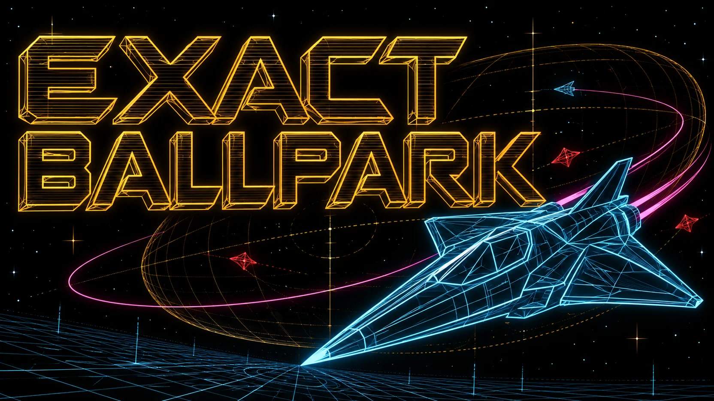
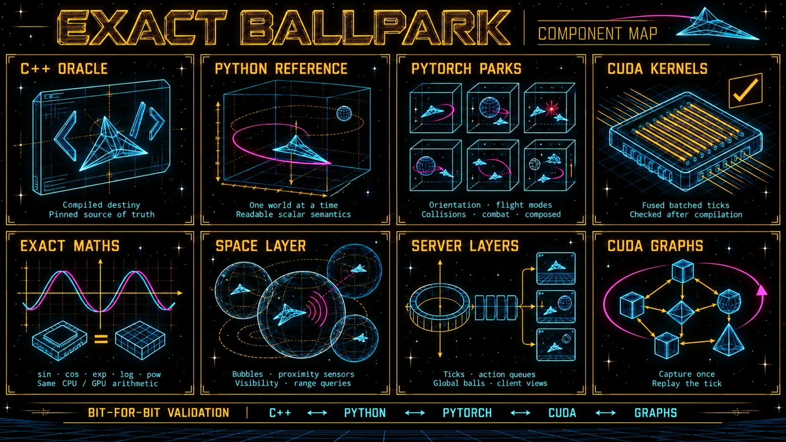

# Exact Ballpark

**Space physics at GPU scale, bit for bit.**

exact-ballpark is an unofficial, independent port of [`destiny`](https://github.com/carbonengine/destiny), the
MIT-licensed space-movement engine published by CCP Games, to Python, PyTorch and CUDA. It steps thousands of
independent worlds at once on one GPU, and every one of them reproduces destiny's own arithmetic, bit for bit.

> **Status: pre-release.** This tree is being prepared for a first public release. The package sources are not in it
> yet.

## Why we built it

At Eidosoma we build **biologically inspired, continual-learning agents**. Like animals, they keep learning throughout
their lives instead of being trained once and frozen. Like species, they can be evolved in populations. Some of them
learn to fly, race, mine, trade and survive in a space simulator, and that asks three things of the engine
underneath them.

- **Fast ticks.** An agent learns only as fast as its world runs. The physics of a tick should cost so little that
  the learner, not the simulator, sets the pace.
- **Many worlds at once.** Reinforcement learning wants thousands of rollouts side by side. Evolutionary algorithms
  and population-based training want whole populations, each agent in a world of its own, scored together and bred
  into the next generation. exact-ballpark steps thousands of independent worlds in one batched call. On the GPU, a
  whole tick can be captured once as a CUDA graph and replayed, with Python out of the loop.
- **Exactness.** An agent that learns for a lifetime should learn the world, not the rounding errors of a numerical
  shortcut. Every world here produces destiny's own bits, so:
  - a run replays identically;
  - two learners can be compared on exactly the same worlds;
  - a surprising behaviour can be traced back to the rule of destiny that caused it.

Speed usually costs exactness. exact-ballpark is our bet that, with enough care, you can have both.

## Benchmarks

> **Coming with the first release.** World-ticks per second at several world counts, measured on an otherwise idle
> NVIDIA GH200, for each layer:
> - the scalar reference;
> - the batched parks on the CPU and on the GPU;
> - the CUDA kernels, stepped eagerly and replayed as CUDA graphs.
>
> Until those runs exist, this repository quotes no speed: every timing so far comes from a shared GPU.

**How busy the GPU stays in our own training runs.** We train agents on four-GPU NVIDIA GH200 nodes: this engine steps
the worlds, and the learners share the same GPUs. Two of our best readings so far:
- **While training:** at least 90.2 % GPU utilisation and 83.6 % SM active, on every one of the four GPUs.
- **Over a whole allocation, start-up and shutdown included:** 85.9 to 86.9 % GPU utilisation and 80.0 to 80.9 % SM
  active.

GPU utilisation is the share of time a kernel was running. SM active is the share of the GPU's streaming
multiprocessors with work. Both were sampled every 5 seconds across the whole device. These figures describe whole
training jobs, simulation and learning together, not the engine alone.

## What's inside

[](docs/assets/exact-ballpark-components-v2.webp)

### The Python reference

A transcription of destiny's C++ into Python, together with destiny's Python server and client layers. It keeps
`float` where destiny computes in `float` and `double` where it computes in `double`, and performs the same operations
in the same order. It is the readable definition of what the engine does, one world at a time, and the yardstick
every faster layer is held to.

### destiny itself, compiled from source (C++)

The conformance kit fetches destiny, carbonengine/math and DirectXMath at pinned commits. It verifies that each
checkout is exactly the pinned tree. It extracts destiny's own C++ from those sources without retyping a line, and
compiles it into small test harnesses with `g++ -O2 -ffp-contract=off -fno-fast-math`. These harnesses are the
oracle: the reference is compared with them value by value, tick by tick.

### The exact maths

destiny's results depend on the C library's elementary functions, and a GPU's own `sin` or `exp` would change the last
bits. So exact-ballpark carries its own, transcribed from the GNU C Library operation for operation, fused
multiply-adds exactly where the library's compiled code has them:
- `sin`, `cos`, `exp`, `log`, `pow`, `asin` and `atan2`;
- `float` versions such as `expf`, `sinf` and `powf`;
- the generator behind `rand()`.

The C++ library's hash-table growth policy is reproduced too, because the order of destiny's sensor lists depends on
it. All of it runs on the CPU and the GPU, with the same bits on both.

### The batched parks, in PyTorch

A park steps many independent worlds at once, with every ball a row of tensors.

| Park | What it simulates |
|---|---|
| `VecOrientPark` | go-to and stop, with destiny's dynamical orientation: ships that turn as they fly |
| `VecModesPark` | the flight modes: go-to, stop, follow, orbit (under both of destiny's laws) and warp |
| `VecCollidePark` | collisions with spheres, capsules, oriented boxes and mini-collidables, force fields, and both of destiny's collision methods |
| `VecCombatPark` | missiles from launch to contact, formations and cloaking |
| `VecComposedPark` | flight modes, missiles (defender missiles included), formations and cloaking, all with ships colliding, in one world |

Above the parks sit two layers:
- **The space layer** (`VecSpace`): destiny's spatial partition, its bubbles, proximity sensors, and visibility and
  range queries.
- **The server layers** (`VecServer`, `SpaceServer`, `CombatServer`):
  - the server's tick and its action queue;
  - one or several bubbles a world;
  - global balls;
  - each client's view of the server.

Every park and layer runs on the CPU or the GPU, with the same results on both.

### Fused CUDA kernels

Hand-written CUDA kernels sit behind the parks and the server layers. A park's tick runs as a short, fixed sequence of
fused kernel launches over every world at once.
- **Compiled on first use,** with the IEEE rules spelled out to `nvcc` (`-fmad=false -prec-div=true -prec-sqrt=true
  -ftz=false`): nothing is contracted into a fused multiply-add, division and square root are correctly rounded, and
  subnormals are kept.
- **Checked after the build.** The PTX of every built library is read back, and a library carrying an approximate,
  flushed or unexpectedly fused floating-point instruction is refused.
- **Cached** under the SHA-256 of their inputs.

### CUDA graphs

Capture a tick once, and replay it every tick after: Python leaves the loop, and a tick's many launches become one.
destiny lets each world tick on its own clock (`OnTick`). The flight-mode, orientation, combat and composed parks
support that as a masked tick, both eagerly and as a graph replay. The server layers support it too, on their PyTorch
paths, and the one-bubble and combat servers also on their kernels.

## How it all comes together

Every layer is held bit-for-bit equal to the one above it by its own tests:

```text
destiny's C++, compiled from the pinned source
      │   equal, value by value, tick by tick
the Python reference
      │   equal, world by world, on the CPU and the GPU
the PyTorch parks: thousands of worlds as tensors
      │   equal, every tensor after every tick
the fused CUDA kernels
      │   equal, replay against eager
CUDA graphs: a whole tick captured once, replayed
```

In a training loop, that looks like this:
1. Build a park with as many worlds as your experiment needs, and load ships into them.
2. Each step, turn your agents' decisions into destiny's commands (go there, orbit that, warp out), one masked command
   per kind for all worlds at once.
3. Tick, eagerly or as a graph replay.
4. Read the state where it already is: tensors on the GPU, ready for the learner.

And when a result surprises you, step the same world through the reference, or through destiny itself, and see
exactly why.

## How we validated it

Exactness is a claim nobody should have to take on trust, so every part of it is a test you can run.

- **Equal means equal.**
  - Every `double` and `float` is compared by its bits, with two NaNs counting as equal.
  - Integers, flags, event lists and byte streams are compared exactly, in order.
  - There is no tolerance anywhere, and no comparison in the final runs of any feature found a difference.
- **destiny is the judge.** The reference is compared with destiny's compiled C++ value by value, tick by tick.
  destiny's behaviour is catalogued as 105 rules, each traced to its lines in destiny's source. 99 pass: 93 against
  the compiled code and 6 against destiny's own published tests. The 6 that do not pass are listed with their reasons
  in [`docs/rules.md`](docs/rules.md).
- **Every link, separately:**
  - the reference against destiny;
  - the parks against the reference, on the CPU and the GPU;
  - the kernels against the parks, every tensor after every tick;
  - a graph replay against the same tick run eagerly.

  Some tests skip links, and hold the kernels to compiled destiny directly.
- **The maths, exhaustively where it can be.** `expf`, `logf`, `sinf`, `cosf`, `acosf` and `atanf` were checked on
  every one of the 4,294,967,296 `float` inputs, on the CPU and on the GPU. On the GPU, `sin`, `cos`, `log` and `exp`
  were checked on 415,236,096 `double` arguments each, concentrated around their branch bounds.
- **Scenarios aimed at the hard cases.** Seeded generators send:
  - ships across the partition's faces;
  - several contacts into one tick;
  - warps that end mid-run;
  - missiles after targets that warp away.

  The reference counts its own branches, and the suite fails if a generator stops reaching one.
- **Held-out seeds.** Code and generators were developed on one or two seeds. Each generator was then frozen, with its
  SHA-256 recorded, before a held-out seed was drawn. A held-out run counted as it came, and no failed seed was ever
  replaced.
- **Tests that are themselves tested.** Every feature's tests must catch faults planted on purpose:
  - a multiply-add contracted;
  - the GPU's own `exp` in place of the transcription;
  - one bit of one table entry flipped;
  - collision contacts in reverse order;
  - a `>` for a `>=`.

  On the collision kernel's development worlds, one contracted multiply-add changes 2,171 (tick, tensor) pairs. When
  a planted fault slipped through, the tests were strengthened, never the code under test, until it was caught.
- **No world depends on its neighbours.** A world must end the same in every setting:
  - alone, among others, or with the batch reversed;
  - at any kernel block size;
  - at large widths: up to 262,144 ships in one batch for the orientation kernel, and 10,000 worlds for the
    one-bubble server kernel.
- **The build checks itself.** A kernel library whose PTX carries an approximate or contracted instruction is
  refused. When a kernel gains an optional feature, its default build's PTX and SASS must stay identical to the build
  before.

Each claim above is a test, and each test is shown to fail when the code is wrong. The volumes, feature by feature,
are in [`docs/exactness.md`](docs/exactness.md).

## Limitations

- **One qualified platform:** destiny compiled with GCC 14.3 against glibc 2.34 on aarch64 Linux, and the NVIDIA GH200
  (sm_90). Elsewhere, exactness is unproven until the same tests pass there.
- **destiny's public source, not a live server.** The claim covers the pinned commit as the conformance kit compiles
  it, and no production build.
- **Many small worlds.** The parks are built for many independent worlds of a few ships each; the space layer holds at
  most 64 balls a world.
- **Not every feature on every path.** Some examples:
  - destiny's optional iterative collision method can be used, and is exact, on the CPU and the GPU through the
    collision park's PyTorch path. It currently has no fused kernel, so a tick that uses it cannot be captured as a
    CUDA graph.
  - The space server's kernel still ticks every world on one clock (its PyTorch path keeps each world's own), and a
    server layer's per-world tick is not yet captured as a CUDA graph.
  - In the combat and composed parks, a graph replay leaves out the eager tick's domain check, so run the check
    between replays.

  A world that leaves a park's domain is flagged and refused, never approximated.
- **Six of the 105 rules are not held to destiny,** each for a stated reason. Space junk and a client's display
  interpolation are not ported.
- **No speeds yet** (see [Benchmarks](#benchmarks)).

The full list, park by park, is in [`docs/limits.md`](docs/limits.md). Every document is listed in
[`docs/README.md`](docs/README.md).

## Requirements and first steps

- Python 3.13 or later. The reference uses `math.fma`.
- PyTorch. Qualified: 2.9.1 with CUDA 12.8.
- pytest, for the tests.
- For the GPU: the CUDA toolkit's `nvcc` and `cuobjdump`, and an NVIDIA GPU. Qualified: nvcc 13.0 on sm_90.
- For the conformance kit: `git` and `g++`, and binutils' `nm` and `objdump`.

```bash
pip install -e .
pytest -m cpu                                   # the reference and the parks on the CPU
python3 conformance/fetch_upstream.py --build   # destiny, carbonengine/math and DirectXMath at their pins; the harnesses
pytest -m oracle                                # the reference against destiny compiled from source
pytest -m gpu                                   # the kernels and CUDA graphs, on an NVIDIA GPU
```

The kit's folders are named in `conformance/kit.toml`. To keep them elsewhere, point `EXACT_BALLPARK_KIT` at a copy of
that file.

## Licence

MIT (`LICENSE`), with one exception. The files that transcribe the GNU C Library's maths are licensed under the GNU
Lesser General Public License, version 2.1 or later (`LICENSES/LGPL-2.1-or-later.txt`), and are marked so in their
headers. `THIRD_PARTY_NOTICES.md` holds the notices of CCP Games, Microsoft, the GNU C Library and its contributors.

## Not affiliated

exact-ballpark is not affiliated with, or endorsed by, CCP Games. CCP Games is a trademark of CCP ehf. Nothing in this
project grants any rights to CCP Games' trademarks or game content.

## Citing

See `CITATION.cff`.
