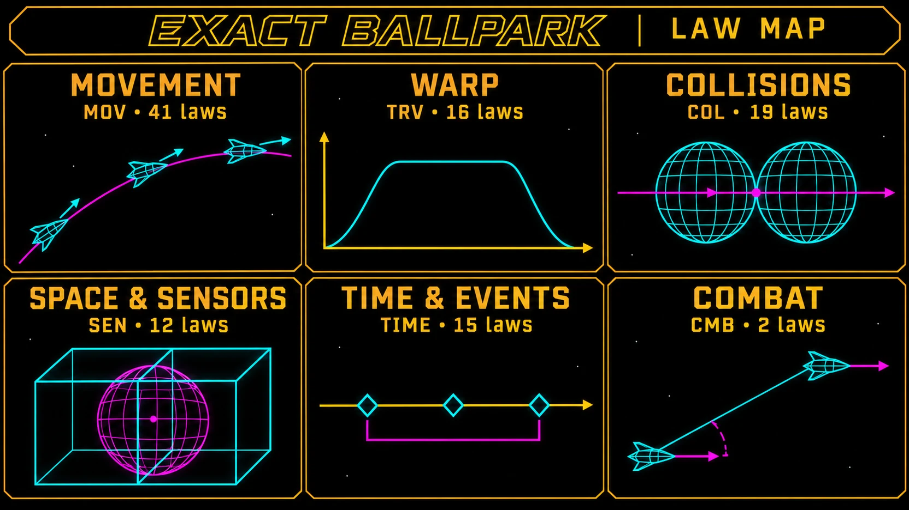

# Exact Ballpark laws in Lean

The Lean register links **105 engine laws** to **430 kernel-checked theorems**. Each entry records the rule ID, the behaviour proved, its assumptions and the evidence from the engine. [Claim register](CLAIMS.md) · [Engine rule catalogue](../docs/rules.md)

[](assets/law-map.webp)

## The six law families

| Family and rule IDs | What the laws govern | One result Lean checks |
| --- | --- | --- |
| **Movement and flight** · 41 · MOV-701–741 | Drag and thrust, GOTO and STOP, following and orbiting, orientation, property setters and numerical primitives. | Over a positive interval with fixed positive effective mass and friction and constant acceleration, the gap to terminal velocity shrinks by exactly the exponential decay factor. [Movement bounds](ExactBallparkProofs/Movement/Bounds.lean) |
| **Warp** · 16 · TRV-701–716 | The command to align, the transition into warp, acceleration, cruise, deceleration and the return to ordinary flight. | A destination strictly closer than 100 km selects GOTO. At or beyond that boundary, repeating the current warp command preserves the ship’s alignment state. [Warp commands](ExactBallparkProofs/Warp/Commands.lean) |
| **Collisions** · 19 · COL-701–719 | Candidate selection, straight sweeps, first contact, overlap correction, elastic response and iterative impacts. | For two spheres moving along straight chords over the reals, the solver returns the earliest contact in the tick, zero for initial overlap, or a miss. [Swept spheres](ExactBallparkProofs/Collision/Sweep.lean) |
| **Space and sensors** · 12 · SEN-701–712 | Partition levels, connected bubbles, proximity events, visibility, cloaking and which clients receive an update. | Starting from a seed box, the bubble traversal labels exactly the initially unassigned boxes reachable through adjacent cells. [Bubble traversal](ExactBallparkProofs/Space/Bubbles.lean) |
| **Time, server and clients** · 15 · TIME-701–715 | Tick duration, backlog, update order, command queues, removal and client synchronization. | In the modeled tick, every ball’s thrust calculation precedes collision responses, and every new state is calculated before the first commit. [Tick schedule](ExactBallparkProofs/Time/Schedule.lean) |
| **Combat** · 2 · CMB-701–702 | How relative motion across the line of sight, tracking and range determine hit probability. | In real arithmetic, distinct positions on the ordinary branch give a hit probability in (0, 1]. With zero transversal speed inside optimal range it equals one. A binary64 radial replay produces +∞. [Real-valued accuracy](ExactBallparkProofs/Combat/Accuracy.lean) · [Finite-arithmetic replay](DISCREPANCIES.md#cmb-702-tracking) |

## Ten proofs behind four discrepancy reports

| Rule | Theorems | What the proofs establish |
| --- | ---: | --- |
| COL-715 · fixed obstacles | 3 | On the first sweep, one second is the only positive duration that picks the nearer obstacle for every pair of distinct positive hit fractions in either order over the reals. For the recorded fractions ¼ and ½, both orders succeed exactly when the duration is greater than 0.5 s and at most 2 s. The binary64 half-second replay checks the failed tie. [Fixed-obstacle proofs](ExactBallparkProofs/Collision/SearchWindow.lean) |
| COL-705 · grazing contact | 2 | An exact zero discriminant always makes the endpoint-based sign check request closer evaluation. On the radius-2²⁸ m graze, the engine rounds one coefficient from 9 to 16. Treating that 16 as exact gives a negative sign for a path that touches halfway through the tick. [Sweep certificates](ExactBallparkProofs/Collision/SweepCertificate.lean) |
| TIME-715 · client queues | 3 | A reply for the final stamp leaves every earlier private group waiting. Waiting only on the first group still blocks a late reply. Once all groups are ready and due, a successful flush that preserves or advances the clock dispatches every payload in order. [Client queue proofs](ExactBallparkProofs/Time/MixedHistory.lean) |
| CMB-702 · sideways motion | 2 | The cross product gives the exact squared angular speed for a nonzero sightline. On the stored radial replay, ordinary binary64 products erase every cross component. The fused multiply-add control recovers all three, including the two nonzero components. [Tracking proofs](ExactBallparkProofs/Combat/TrackingMargin.lean) |

The CPU gate compares collision IDs and timestamp bits at five tick lengths, queue payloads and clocks for histories of two, three and five stamps, and tracking components against CPython’s fused multiply-add and an exact rational reference. The register links each comparison to its theorem. [Claims and CPU evidence](CLAIMS.md#claim-178) · [Gameplay impact](DISCREPANCIES.md#what-a-player-might-notice)

## Proofs across seven engine behaviours

These 37 theorems follow seven engine behaviours beyond a single formula or tick. The register gives the assumptions and engine symbols for each claim. [Claim register](CLAIMS.md#claim-170)

| Area | Theorems | What the proofs establish |
| --- | ---: | --- |
| STOP | 5 | Over any number of ordinary, collision-free ticks, position and velocity on each axis have closed forms. From the same positive initial speed, vertical damping shortens the stopping distance. Two half-ticks apply that damping twice. [Stopping distance and energy](ExactBallparkProofs/Movement/StopDistance.lean) |
| Orbit steering | 6 | The old orbit’s seven-place Gaussian weight reaches zero once the squared radius error exceeds 40000 log(10⁷). For new orbit, the blend gives explicit position and velocity errors before clipping. The acceleration cap preserves a conditional speed bound. [Orbit steering](ExactBallparkProofs/Movement/OrbitSteering.lean) |
| Iterative collision response | 6 | In a closing head-on pair, momentum survives the two per-ship limits exactly when both retain the same fraction of the raw impulse. In one equal-mass example the ships’ velocities change from −100 and −90 m/s to −97.5 and −100 m/s. Their combined kinetic energy increases by 703.125 J in that frame. [Limited pair](ExactBallparkProofs/Collision/LimitedPair.lean) |
| Static collision boxes | 5 | The eight corners determine exact coordinate bounds for the whole solid. If the real broad phase rejects a sphere’s straight sweep, it misses every point of the box throughout the interval. The half-diagonal bounds the solid for perpendicular box edges. [Solid boxes](ExactBallparkProofs/Collision/SolidBox.lean) |
| Range and target tracking | 5 | Each channel emits membership changes in order. Setting the same notification range again can produce a second enter without any movement. The binary64 trace exercises strict boundaries and the minimum active tracking range. [Range callbacks](ExactBallparkProofs/Space/RangeAlerts.lean) |
| Delayed removal | 5 | Each cleanup removes all overdue entries and the first seven eligible early entries. Repeated polls at the same wall time can drain 17 early entries in groups of 7, 7 and 3 while the simulation clock stays fixed. The identity of the first seven depends on traversal order. [Cleanup window](ExactBallparkProofs/Time/CleanupWindow.lean) |
| Combat accuracy | 5 | In the real ordinary calculation, motion along the line of sight leaves the angular penalty unchanged. For radial motion, one falloff length beyond optimal gives a hit probability of ½, and two give ¹⁄₁₆. Distances are measured from the surfaces. [Tracking and falloff](ExactBallparkProofs/Combat/Falloff.lean) |

The CPU gate compares the new laws with scalar entry points. It reads callback and cleanup traces and the exact collision witness from Lean. With `--destiny-repo`, the collision replay also checks the velocities stored by the pinned C++ engine. Closed-form distance, energy, orbit and box results use real arithmetic. The register records finite-arithmetic evidence separately. [CPU controls](scripts/boundary_checks.py) · [Compiled collision replay](scripts/contact_replay.py)

## Ten claims across engine systems

A ship touching a sensor at 12 m produces a callback on the fourth poll in this scene. The distant pilot receives nothing. What a local pilot sees depends on what the application queues after the callback. The register now follows that distinction through server routing and applies the same source checks to movement, warp, tracking and physics. [Claims by rule](CLAIMS.md#catalogue-coverage)

| Area | What Lean checks | What the CPU replay observes |
| --- | --- | --- |
| 1. Sensor boundary | With two 1 m radii, 10 m range and a two-second period, the fourth poll at exactly 12 m enters, an inside repeat is quiet and the eighth poll leaves. | Every elapsed-time word, membership flag and callback matches in a session that moves the target through the spatial index. [Sensor trace](ExactBallparkProofs/Space/SensorDelivery.lean) |
| 2. Who receives the event | The stock ball callback yields an empty server history. If the application queues a radius change on each edge, the two actions reach clients interested in an interactive ball in the owner’s known, live bubble on polls five and nine. | Two local pilots receive those actions. A distant pilot receives neither. The routing fixture also exercises dead and missing bubbles through five original Destiny Python methods. [Delivery theorem](ExactBallparkProofs/Space/SensorDelivery.lean) |
| 3. Warp to ordinary flight | One aligned, 131,072 m warp at factor 4000 activates at stamp 0. At stamp 9 its sampled speed falls below 50 m/s. Drag acts on the sampled state before commit, and the next STOP tick starts from the committed pair. | All 11 stored axial positions, velocities and modes agree with scalar Python and compiled Destiny C++. The proof uses 11 supplied exp words and two log words. [Warp journey](ExactBallparkProofs/Warp/Journey.lean) |
| 4. Formation slots | The engine’s real quaternion matrix preserves every slot’s distance for a unit quaternion, including the zero slot. | Identity, a rotation cycling the axes and a half-turn put the follower’s target at the expected coordinates after the binary32 transform. [Formation rotation](ExactBallparkProofs/Movement/FormationRotation.lean) |
| 5. Force-field access | After the two queued configuration writes, the field appears once for a ship denied access and disappears for a permitted ship, assuming both pass the common spatial filters. | Two ships query the same boxes under five access settings and a queued disable. An ordinary massive neighbour stays visible. [Field query](ExactBallparkProofs/Space/FieldQuery.lean) |
| 6. First movement after GOTO | With one accepted command after startup, the uplink delay counts command-free ticks. The flushed stamp is the start of the first affected interval. | A ship at rest receives a command issued after tick 3. The event is stamped 4 and the first changed position is committed at 5. [Command timing](ExactBallparkProofs/Time/CommandFlight.lean) |
| 7. Rewind after a late GOTO | If the retained stream restores the movement state at its own stamp, deterministic replay to the command stamp and beyond gives the same ball state as on-time delivery. | Delaying that packet by one tick makes the client predict the wrong position first. After rewind, all position and velocity words and the mode match at the common stamp. [Client rewind](ExactBallparkProofs/Time/CommandFlight.lean) |
| 8. Tracking arithmetic | With a finite positive squared distance, comparing the aligned integer significands of the finite nonnegative squared speeds can certify the sign of the eventual binary64 square-root input before subtraction or division. | The guard rejects the known failing radial case and accepts both a perpendicular velocity and an exact radial cancellation. [Sign proof](ExactBallparkProofs/Combat/InputMargin.lean) · [Radial discrepancy](DISCREPANCIES.md#cmb-702-tracking) |
| 9. Mixed-world ticking | In the row-local GOTO/STOP model, each ship uses the same tick arithmetic and cached factor as its solo run. With any sequence of per-world masks, its movement state and clock match the solo run after exactly its due updates. | Five polls compare both PyTorch CPU worlds with solo parks and Lean, including alternating deadlines, a shared tick and a stored negative zero. [World masks](ExactBallparkProofs/Movement/WorldMask.lean) |
| 10. Energy over a manoeuvre | Across any finite sequence of constant-thrust intervals with fixed positive effective mass and drag, kinetic energy changes by total thrust work minus total drag loss. Drag loss is nonnegative. | A turn followed by a coast is checked using independent 70-digit integrals and the three scalar velocity components. The physical claim covers continuous flight between instantaneous velocity changes. [Work account](ExactBallparkProofs/Movement/Manoeuvre.lean) |

The standard gate runs the Lean and host comparisons. Adding `--destiny-repo /path/to/destiny` compiles the original flight and collision methods and exercises five original Python server methods with fixture parks and transports. [CPU checks](scripts/law_trace_checks.py) · [Run the gate](#verify-locally)

## Scalar movement across ticks

Start a scalar park, add two ships, send them different commands, and stop after any completed operation. Lean proves that each ship has exactly the state obtained by replaying its own commands and every tick in isolation. This includes position, velocity, target, last thrust, mode, properties and the stored decay factor. The clock counts ticks even in an empty park. Splitting a trace and resuming from the intermediate state gives the same result. [Trace theorems](ExactBallparkProofs/Movement/ScalarTrace.lean)

| Scope | What the result covers |
| --- | --- |
| Commands and ticks | Add or replace a ball, GOTO by point or direction, STOP and the five scalar property setters. Each full tick prepares every ball, stages the three-coordinate results and commits. STOP damps vertical velocity even at zero duration. An accepted mass or agility write refreshes the cache. [Commands](ExactBallparkProofs/Movement/ScalarCommands.lean) · [Source translation](ExactBallparkProofs/Movement/ScalarReference.lean) |
| Admitted inputs | The configuration uses a fixed finite nonnegative stored duration and a fixed positive finite friction whose binary64 square is nonzero. Commands target live IDs except when adding a ball. Binary32 setter conversion must succeed, and a GOTO tick requires a nonzero effective mass. The runtime comparison starts at the scalar API with three-component vectors and no external mutation. [Domain and runner](ExactBallparkProofs/Movement/ScalarTrace.lean) |
| CPU evidence | The gate compares 202 movement trace prefixes and 3 rejected suffixes with CPython. It checks the stamp, ordered IDs, mode and every stored floating-point word after each completed operation, with both NaNs treated as equal. The traces exercise both drag branches, interleaved commands, replacement, signed zeros and a zero-duration tick. [Replay](scripts/scalar_trace_checks.py) |

**Connection to physics.** Start at 100 m/s horizontally, with effective mass and friction both 1, no thrust and one-second ticks. After five seconds the continuous drag law gives velocity `100 exp(−5)` and displacement `100 (1 − exp(−5))`. Using the CPU’s word for `exp(−1)`, Lean evaluates the five binary64 ticks and proves that the final errors are below **10⁻¹⁴ m** and **10⁻¹⁵ m/s**. A second theorem propagates position and velocity error over any finite sequence of ordinary steps given the same force inputs, decay-error bounds and matching rounding grids. These claims use an ideal linear-drag model. Predicting measured motion would also require physical data for the forces and coefficients. [Five-second coast](ExactBallparkProofs/Movement/CoastWitness.lean) · [Trajectory error](ExactBallparkProofs/Movement/RegularTrajectory.lean)

The scalar proofs use a source translation for tick arithmetic, reviewed transcriptions for commands and a supplied exponential function. In the five-second coast, the pinned Destiny C++ movement functions also matched all three position words and all three velocity words at each tick on x86-64 Linux with GCC 11.4. Collision response, other flight modes and fused CUDA ticks have separate evidence. [Claim register](CLAIMS.md) · [Platform qualification](../docs/platform.md)

## Energy and physical units

For an ordinary flight interval, let `m = mass × agility`, let `k` be friction, and hold the applied acceleration `a` constant. Lean proves that the change in kinetic energy equals the time integral of thrust power minus drag loss. The proof starts from the three velocity components in the translated scalar integrator and uses mathlib’s derivative of the squared norm and fundamental theorem of calculus. It assumes positive constant `m` and `k`, with the exact decay when the engine reads its full-tick cache. [Energy proof](ExactBallparkProofs/Movement/Energy.lean) · [Squared-norm derivative](https://github.com/leanprover-community/mathlib4/blob/fc4f59e577feb1a4956671bc04ac18aaaf8cd842/Mathlib/Analysis/InnerProductSpace/Calculus.lean#L216) · [Integral theorem](https://github.com/leanprover-community/mathlib4/blob/fc4f59e577feb1a4956671bc04ac18aaaf8cd842/Mathlib/MeasureTheory/Integral/IntervalIntegral/FundThmCalculus.lean#L1148)

| Quantity | What Lean establishes |
| --- | --- |
| Kinetic energy | For `E = m ‖v‖² / 2`, the instantaneous rate is `m (v · a) − k ‖v‖²`. An unforced ship with nonzero initial speed loses energy on every positive interval. If its speed halves, it retains one quarter of its initial kinetic energy. This describes the continuous drag interval between commands and collision impulses. |
| Decay factor | Assigning units of mass per time to friction makes `−k Δt / m` dimensionless. Taking its real exponential gives the positive-mass cache refresh. [Typed decay](ExactBallparkProofs/Physics/Units.lean) |
| Fixed-obstacle contact | Physlib gives sweep fractions and seconds distinct types. In a window from 0.5 to 1 s, fractions ¼ and ½ become 0.625 and 0.75 s. Comparing timestamps selects the earlier obstacle in either order. The scalar engine and pinned Destiny can select the later obstacle by comparing ½ directly with 0.625. [Typed comparisons](ExactBallparkProofs/Physics/Units.lean) · [Replay](DISCREPANCIES.md#col-715-fixed-window) |

The velocity proof also applies to MOV-703, which shares the ordinary velocity update. The interpretation of work along the ship’s path uses the ordinary position formula where the derivative of position equals velocity. Binary64 trajectory errors have separate bounds. [Integration branches](ExactBallparkProofs/Movement/SpecialBranch.lean) · [Trajectory bounds](ExactBallparkProofs/Movement/RegularTrajectory.lean)

## Clearance throughout a tick

COL-705 sweeps a straight line between the two positions stored for each body. A turning ship follows a curve under the ordinary drag equation. Lean now proves when a straight-sweep miss guarantees that the two spherical surfaces stayed apart for the entire interval. [Movement proof](ExactBallparkProofs/Movement/DragChord.lean) · [Clearance proof](ExactBallparkProofs/Collision/CurveClearance.lean)

For effective mass `m = mass × agility`, fixed positive friction `k` and held acceleration `a`, the initial net acceleration has magnitude `A = ‖a − (k/m)v₀‖`. Its magnitude then decays exponentially. At every common time in a tick of duration `T`, the distance from the straight interpolation is at most **A T²/8 metres**. Halving the interval quarters this bound for the same acceleration limit. This applies between changes of thrust or coefficients and between impacts. The ordinary integrator supplies the positions when its branch guard holds and its full-tick cache has the stated decay. [Trajectory uniqueness and chord bound](ExactBallparkProofs/Movement/DragChord.lean)

The CPU checker reads the four binary64 endpoint positions, combined radius, duration and a budget for each body. It checks the engine miss word, finds the closest point on the relative straight segment using exact rationals, and rounds the centre-distance lower bound down to a micrometre. It subtracts the combined radius, each body's curvature allowance and the larger of that body's start and end errors. **Certified clear** gives the remaining surface gap in metres, conditional on the supplied bounds covering both motions. **Insufficient clearance** means the checker could not establish a positive gap. The existing ordinary-step rounding proof can supply coordinate errors, and the new theorem combines them into a Euclidean bound. [Checker](scripts/CurveClearance.lean) · [Endpoint budgets](ExactBallparkProofs/Collision/CurveClearance.lean)

| Fixed obstacle | Scalar and Destiny sweep | Continuous motion for a one-second GOTO turn |
| --- | --- | --- |
| (4, 1, 0) m | Miss | The centres are less than 0.1 m apart at half a second, inside the 0.5 m combined radius. |
| (4, −4, 0) m | Miss | The surfaces stay at least **3.094137999999 m** apart. Lean discharges the acceleration and endpoint error assumptions for both bodies. |

The gate runs 13 curve clearance checks, including two moving bodies, touching endpoints, invalid input and a floating-point false hit. The full turning fixture and its pinned C++ replay are recorded in the discrepancy log. [Witness proof](ExactBallparkProofs/Collision/TurningFlight.lean) · [Game rule and replay](DISCREPANCIES.md#col-705-turning-path)

From `lean/`, run the two examples or give the checker a JSON file.

```bash
lake env lean --run scripts/CurveClearance.lean --demo
lake env lean --run scripts/CurveClearance.lean --file request.json
```

This input describes two stationary centres 5 m apart with a combined radius of 1 m. The checker returns a 4 m surface margin.

```json
{
  "radius": 1, "duration": 1,
  "first":  {"start": [0,0,0], "end": [0,0,0], "accelerationBound": 0, "startError": 0, "endError": 0},
  "second": {"start": [3,4,0], "end": [3,4,0], "accelerationBound": 0, "startError": 0, "endError": 0}
}
```

Coordinates, radius and endpoint errors are in metres, duration in seconds, and acceleration bounds in m/s². The supplied radius must cover the sum of the physical radii for the reported surface margin to apply. Budget and duration decimals are read as exact rationals. Coordinates and radius are read as binary64. To supply an original binary64 word, use an object such as `{"bits": 4602678819172646912}` for 0.5. The checker reports the engine's time-of-impact word and returns certified margins as exact fractions of a metre.

### First contact along a turn

The first-contact checker takes each sphere’s initial position, velocity, constant applied acceleration, effective mass and friction. It bounds both centres throughout each time interval using rational arithmetic and mathlib’s exponential remainder bound. A hit requires a sample at or inside the combined radius and proof that the entire earlier prefix was clear. This works even when the spheres separate again before the tick ends. [Position bounds](ExactBallparkProofs/Movement/PositionEnclosure.lean) · [First-contact proof](ExactBallparkProofs/Collision/ContactCertificate.lean)

| CPU result | What it establishes |
| --- | --- |
| `first contact in window` | The earliest touch or overlap occurs between `loSeconds` and `hiSeconds`, inclusive. Initial contact gives [0, 0]. |
| `certified clear` | The surfaces stay strictly apart for the whole interval. When present, `marginMetres` is a lower bound on their gap. |
| `unresolved` | The checker could not certify either outcome. A graze between samples can produce this result. |

Run the one-second GOTO replay from `lean/`.

```bash
lake env lean --run scripts/CurveClearance.lean --contact-demo
```

The engine chord reports a miss for both obstacles. At (4, 1, 0) m, the continuous path first touches in **[0.435661, 0.435662] s**. At (4, −4, 0) m, the position bounds give **3.5 m** of surface clearance. The endpoint-and-acceleration certificate above gives 3.094137999999 m on the same control. [Kernel-checked examples](ExactBallparkProofs/Collision/ContactExamples.lean) · [Scalar and Destiny replay](DISCREPANCIES.md#col-705-turning-path)

For two moving spheres, pass the following JSON using `--file`. Each moves at 2 m/s towards the other. The reported first-contact window is **[0.499999, 0.500000] s**.

```json
{
  "mode": "firstContact", "radius": 1, "duration": 1, "cells": 1000000,
  "first":  {"start": [0,0,0], "end": [2,0,0], "velocity": [2,0,0], "applied": [2,0,0], "effectiveMass": 1, "friction": 1},
  "second": {"start": [3,0,0], "end": [1,0,0], "velocity": [-2,0,0], "applied": [-2,0,0], "effectiveMass": 1, "friction": 1}
}
```

Times are seconds from the start of the interval. The default grid has one million cells, also the maximum. The search skips intervals it proves clear and stops at the first undecidable cell. The model requires positive effective mass and friction, the ordinary position branch throughout, a fixed applied acceleration in m/s² and the exact **sum of the radii** in metres. State and radius words decode to exact rationals. The supplied `end` positions feed the engine chord comparison. Its `sweepDecision` and `sweepTimeBits` describe the binary64 contact fraction on that chord. The continuous result starts from the two initial states. Apply it up to the first impact or command that changes either trajectory.

The gate runs 23 first-contact checks. When both ships turn with different drag coefficients per unit mass, the checker proves first contact in **[0.404889, 0.404890] s**. The binary64 sweep misses. Other cases cover grazing contact, a prefix that needs subdivision, and a hit after one decay time. For two eligible obstacles on one clock, disjoint first-contact windows establish which one is reached earlier. In the COL-715 half-tick fixture this selects the obstacle at x = 3 m before the one at x = 5 m. Overlapping windows leave their order open. [CPU checks](scripts/curve_checks.py) · [Obstacle-order proof](ExactBallparkProofs/Collision/FirstContact.lean) · [COL-715 engine replay](DISCREPANCIES.md#col-715-fixed-window)

### One impact through the end of a tick

The CPU gate replays **3 one-impact ticks** in iterative collision mode. Two free spheres of radius 0.5 m start at x = 0 and 3 m, heading towards each other at 2 m/s. Distant GOTO targets keep their incoming velocities constant. Lean proves the first contact is exactly **0.5 s**, at x = 1 and 2 m, then uses the collision normal and base masses to calculate the impulses. Each ball resumes drag from its contact position and updated velocity for the remaining half-second. [Incoming paths and rebound](ExactBallparkProofs/Collision/ReboundFlight.lean)

| Case | Left x (m) | Left vx (m/s) | Right x (m) | Right vx (m/s) |
| --- | ---: | ---: | ---: | ---: |
| Equal | 0.426123 | -0.426123 | 2.573877 | 0.426123 |
| Unequal | -0.098503 | -1.234830 | 2.049252 | -0.382585 |
| Limited | 1.385204 | 1.052296 | 2.573877 | 0.426123 |

The table shows committed values at one second, rounded to six decimals. In the equal-mass case the ships exchange velocities. Doubling the right ship's base mass and halving its agility preserves its incoming drag but changes the impulses to −16/3 and +8/3 m/s. The limited case uses equal unit masses and sets the left ship's maximum speed to 0.5 m/s with a constructor speed fraction of four. Its proposed −4 m/s change becomes −1.5625 m/s. The right ship receives +4 m/s, so the pair gains 2.4375 kg m/s of momentum at impact. [Impulse and limiter proofs](ExactBallparkProofs/Collision/ReboundFlight.lean)

**All three pairs touch only once.** In the limited case the ships are closing again at the end, with about 0.189 m between their surfaces. The proof covers the intervening times by bounding the signed separation under drag. For collinear flights starting at contact with shared drag parameters, it suffices that the outgoing right-minus-left velocity is at least its terminal value and the right centre finishes more than the combined radius ahead of the left centre. [Separation proof](ExactBallparkProofs/Collision/ReboundFlight.lean)

Lean, scalar Python and pinned Destiny C++ agree on 29 binary64 words per ball, including the raw and applied changes, the stored contact and the final state. The Lean replay takes the two host exponential words as inputs. A separate proof encloses the real exponential and bounds the final x-position error by **10⁻¹⁵ m** and x-velocity error by **10⁻¹⁵ m/s** for both balls in each fixture. The scenarios use one eligible pair, constant applied acceleration and disabled spin. [Word replay](ExactBallparkProofs/Collision/ReboundTick.lean) · [Endpoint error proof](ExactBallparkProofs/Collision/ReboundAccuracy.lean) · [Scalar comparison](scripts/rebound_checks.py)

From `lean/`, print the six records with their original binary64 words.

```bash
lake env lean --run scripts/ReboundTick.lean
```

## Ten new proofs

| Rules | What the proof establishes |
| --- | --- |
| MOV-702–704 | With matching partial-tick decay bits, every tensor coordinate returns the scalar position and velocity words, including a zero-length step and the special branch. [Tensor lanes](ExactBallparkProofs/Movement/TensorLane.lean) |
| COL-705, 715, 718 | A full 100 ms tick from three starting states finds the contact that reads the wrong velocity. Lean checks all contact times, indices, impulses and the two final states. [Rebound replay](DISCREPANCIES.md#col-715-history-lookup) |
| MOV-702, 704 | Position and velocity each have a forward error bound for the ordinary formula extracted from Python. The calculation accounts for operation rounding and an error in the supplied decay factor. [Regular drag](ExactBallparkProofs/Movement/RegularError.lean) |
| SEN-706, COL-703 | Given an interior overlap with enough margin for face-test rounding, the two bodies appear in each other’s candidate lists, including across filing levels. The regular-drag speed envelope supplies one bound on travel. [Swept candidates](ExactBallparkProofs/Space/SweepCandidates.lean) |
| COL-701, 711 | The default gradient keeps the latest ordinary ball hit. At equal times it keeps the stronger scaled response, retaining the first candidate at equal strength. [Gradient winner](ExactBallparkProofs/Collision/GradientWinner.lean) |
| COL-705 | A successful certificate brackets the exact first contact and the binary64 answer inside the tick. At depth 24 the maximum time difference is 2⁻²⁴ of a tick. [Hit certificate](ExactBallparkProofs/Collision/HitCertificate.lean) |
| MOV-731, TIME-710, 712 | On the master, cleanup applies a remote follower’s Stop before the bubble update. It clears the follow fields and releases the leader’s membership, including when a Stop was already queued. [Follower cleanup](ExactBallparkProofs/Time/FollowerTick.lean) |
| SEN-712, TIME-715 | When the private and bubble packets share an earlier stamp, their events merge there. A later private stamp in that same packet stays waiting. A server/client replay compares normal and postponed sends. [Packet proof](ExactBallparkProofs/Time/BatchStamps.lean) |
| MOV-738 | On stored negative drag arguments from −1 to −2⁻⁵⁴, the first software FMA in the exponential gives the exact reduction value. The CPU gate exercises 743 first-reduction inputs across all 186 reachable indices. [First reduction](ExactBallparkProofs/Numerics/ExpFirstFma.lean) |
| CMB-702 | A certificate computes how much transversal speed is enough to keep the angular-speed square root in range. The logged radial input falls below that margin. [Tracking margin](ExactBallparkProofs/Combat/TrackingMargin.lean) |

## Earlier proof batches

The previous 20 proofs cover five parts of the engine.

| Area | Proofs | What they establish |
| --- | ---: | --- |
| Capsule collisions | 5 | When a straight sweep reaches the barrel branch and the root lies between the caps, it gives first contact. A binary64 witness shows why the near-parallel guard can discard a real crossing. [Capsule proofs](ExactBallparkProofs/Collision/Capsule.lean) |
| Client history | 5 | Merging preserves stamp and event order. The dispatch loop consumes a prefix and stops at its first blocked group. Lean and the scalar client agree on 112 mixed-stamp histories. [History proofs](ExactBallparkProofs/Time/MixedHistory.lean) |
| Exponential arithmetic | 5 | The signed reduction index fits its integer operations, both table loads stay in bounds and the scale-word shifts preserve the significand. At magnitudes below 2⁻⁵⁴, the engine’s tiny-input result agrees with correctly rounded exp. [Reduction proofs](ExactBallparkProofs/Numerics/ExpReduction.lean) |
| Warp sampling | 3 | The sampler can keep an incoming speed above the derivative of its position curve. During the extra deceleration second, a sample can pass the nominal exit by less than one metre and reverse the next sightline. [Warp samples](ExactBallparkProofs/Warp/Sampling.lean) |
| Range queries | 2 | At a ball’s coordinates in the same bubble, querying by ID drops just that ball. The survivors retain dictionary order and the distance form returns squared center distances. [Range proofs](ExactBallparkProofs/Space/RangeScan.lean) |

The CPU probe calls the engine’s exponential on 640 non-tiny inputs, records both table reads for every lane and compares the final binary64 words with a 100-digit decimal reference. All 128 slots are visited in each of five signed reduction ranges, including one with subnormal results. The sampling checks also cover eight tiny inputs, the sightline on either side of a warp exit and the range-query overloads. [Sampling checks](scripts/sampling_checks.py)

Earlier proofs include the four-ball collision replay through its final position and velocity bits, a strict visibility-ray entry test, the server’s seven-ball cleanup budget and the client’s merge of private and bubble events. For combat, Lean checks the exact tracking calculation that sends a negative squared speed to the square root and a large positive exponent to the power function. [Collision replay](ExactBallparkProofs/Collision/ReplayTick.lean) · [Visibility](ExactBallparkProofs/Space/Occlusion.lean) · [Removal](ExactBallparkProofs/Time/RemovalMasks.lean) · [Client delivery](ExactBallparkProofs/Space/MergeDelivery.lean) · [Combat discrepancy](DISCREPANCIES.md#cmb-702-tracking)

The floating-point proofs follow the CPU’s software fused multiply-add. Knuth’s six operations recover the exact addition residual in a 53-bit nearest-even model. For the partial-product widths and exponent grids stated in the register, composing Dekker’s product, TwoSum and the round-to-odd step yields the exact product-plus-add rounded once. Applying that result to every call inside the engine’s exponential still requires proving its operands meet those conditions. [TwoSum](ExactBallparkProofs/Numerics/TwoSum.lean) · [Product and limiter](ExactBallparkProofs/Numerics/Product.lean) · [Round-to-odd and FMA](ExactBallparkProofs/Numerics/OddFma.lean)

The collision-order proofs follow candidates from spatial filing to the time-of-impact decision. For ordinary interior filings, the scalar tree and the tensor sort return the same ordered IDs. CPU probes compare **54 ordered candidate lists** and their packed keys across eight levels and both tensor sorting paths. They also run the face tests on the stored binary64 inputs. The movement bound explains when the filing radius covers the entire regular drag trajectory. The collision proofs cover minimum-time selection, ties, partial windows and repeated free-ball hits. [Candidate order](ExactBallparkProofs/Space/CandidateOrder.lean) · [Filing radius](ExactBallparkProofs/Space/FilingRadius.lean) · [Collision search](ExactBallparkProofs/Collision/SearchWindow.lean)

The formation proofs cover flight commands under MOV-726. If a ship requests a slot beyond the end of a formation, it keeps following its old leader. If the slot fits but the new leader is cloaked or in another bubble, the ship stops. Shrinking a formation on the master releases the slots of the ships it stops. A reservation with no ship attached can survive the shrink and block that slot when the formation grows again. The CPU check compares Lean with the scalar engine on 147 reservations, 63 releases, 280 joins and 50 resize sequences. [Formation proofs](ExactBallparkProofs/Movement/Formation.lean) · [Resize documentation discrepancy](DISCREPANCIES.md#formation-resize-documentation)

The server and client proofs follow an update from server batching to client rewind. A client with both private and bubble events receives the private updates first, with a flag telling it to wait for the bubble. On the client, an eleventh snapshot trims the cache to its original base and the five newest streams. If two saved streams have the requested stamp, a rewind restores the last eligible one in storage order. CPU checks compare Lean with the scalar engine on 50 outgoing batches and 133 snapshot operations. [Server batches](ExactBallparkProofs/Space/Batches.lean) · [Client snapshots](ExactBallparkProofs/Time/Snapshots.lean)

## Observed engine discrepancies

The log ranks 13 behaviors by their consequence on the replayed inputs. A 9.9 µm step through a capsule wall misses, and the next query from inside detects contact at time zero. Both mixed-stamp client cases report a fatal desync before admission. If the handler returns, a delayed server send can leave a command waiting. In a separate crafted packet spanning a reset, event order decides which commands survive. [Gameplay impact review](DISCREPANCIES.md#what-a-player-might-notice) · [Capsule crossing](DISCREPANCIES.md#col-712-shallow-crossing) · [Extra wait](DISCREPANCIES.md#time-715-extra-wait) · [Reset order](DISCREPANCIES.md#time-715-reset-order)

**COL-715 · A farther fixed obstacle can win.** On the first sweep of a 0.5 s tick, visiting the farther obstacle first can retain the 0.25 s contact over the 0.125 s one. In a separate one-second encounter with three fixed obstacles, correcting the comparison after a rebound reversed the ship’s final direction. [First sweep and four-ball replay](DISCREPANCIES.md#col-715-fixed-window)

**COL-715 · A lookup can select the pre-impact velocity.** The supplied-contact replay measured 1.22 m of separation. The separate three-ball tick reaches a rounding boundary at two adjacent starting positions in a scan of 33. At the logged position the engine misses the second rebound, stores a rightward third rebound, then commits from an older leftward record. It finishes 1.325268 m from the exact-cutoff control. At a contact gap one nanosecond shorter, both runs miss the second rebound. [History proofs](ExactBallparkProofs/Collision/ImpactHistory.lean) · [Lookup discrepancy and replay](DISCREPANCIES.md#col-715-history-lookup)

**CMB-702 · Nearly radial motion can yield undefined angular speed.** A seeded CPU sample reproduced this in 36.2% of 20,000 constructed radial targets. On the documented target the chance at tracking ratio 200 still accepts every binary64 uniform hit draw. At 10³⁰ the engine returns infinity and the exact probability on the stored inputs rounds to zero. [Tracking ratios and exact reference](DISCREPANCIES.md#cmb-702-tracking)

**COL-715 · A second free-ball hit can disappear.** With a supplied turn in the other ball’s history, the engine kept the old start positions after suppressing a repeat. The two-chord search missed a hit that the final chord alone reported at 0.708901778 s. [Repeat-contact replay](DISCREPANCIES.md#col-715-free-repeat)

**COL-705 · A missed sphere can register a hit.** A ship sweeps from (−2²⁸, 2, 0) to (2²⁸, 2, 0) past a stationary sphere at the origin, with combined radius one metre. The closest approach is two metres. In binary64, cancellation makes the quadratic discriminant zero. Lean proves the real miss and the rounded contact at half a tick. The scalar Python check reproduces that contact. [Finite sweep proof](ExactBallparkProofs/Collision/FiniteSweep.lean)

Move the same sweep out to five metres and Lean can certify the miss from the endpoint bits alone. An offline checker bounds the rounding error in the discriminant. When its entire interval lies below zero, both the modeled binary64 solver and the exact straight-chord solver return −1. At the original two-metre offset the interval contains zero and the checker returns “uncertain.” A positive discriminant still requires a check that the first root falls within the tick. [Sweep certificate](ExactBallparkProofs/Collision/SweepCertificate.lean)

The timing proof checks bounds on the first root against both tick endpoints. For a sweep from x = 4 to the next binary64 value above 1, Lean places first contact strictly after the tick. Scalar Python and pinned Destiny C++ both report contact at exactly 1. At exact tangency the opposite error is possible. In a six-metre sweep that touches halfway through the tick, the rounded discriminant is −1008 and both engines return a miss. [Timing proof](ExactBallparkProofs/Collision/Timing.lean) · [Discrepancy log](DISCREPANCIES.md)

**COL-718 · The impact limiter can admit an impulse just above its nominal bound.** For a maximum speed of 4097, five times that speed is 20485. The engine rounds the squared threshold in binary32 and accepts a change of 20485 + 2⁻¹³ along one axis. [Ideal response proofs](ExactBallparkProofs/Collision/Impact.lean) · [Mixed-precision witness](ExactBallparkProofs/Collision/FiniteImpact.lean) · [CPU replay](DISCREPANCIES.md#col-718-impact-limit)

**MOV-703 · Position rounding depends on thrust and coordinate scale.** FloatLib bounds each of the 16 rounded operations in the branch. Together they give the documented error bound relative to the branch’s first-order position update. For the extreme prescribed acceleration in the Lean witness, the stored position is +0 m, the first-order branch gives 1 m over the reals, and the regular drag trajectory gives about 524,289 m. With full GOTO thrust at a configured 10,000 m/s, the measured branch error was 0.583 pm from the origin and 30.518 µm from one AU. [Rounding proof](ExactBallparkProofs/Movement/Roundoff.lean) · [CPU measurements](DISCREPANCIES.md#mov-703-position)

**TRV-709 · Short warps can have a tiny negative cruise duration.** At factor 1000, trips of 100,000 and 100,001 metres both have zero cruise in exact arithmetic. The engine rounds them to opposite sides of zero. Both sampled ships exited warp on the same tick as their zero-cruise controls. [Warp discrepancy and replay](DISCREPANCIES.md#trv-709-short-cruise)

## What connects a theorem to the engine

| Python source | How it enters Lean | Scope |
| --- | --- | --- |
| `Ballpark.integrate` | A restricted translator reads the guards, cached decay factor and order of arithmetic for one coordinate. | The extracted real program equals the integrator used in the trajectory proofs. A second translation models binary64 operations with the exponential supplied as an input function. |
| `Ballpark.evolve` and its GOTO, STOP and cache calculations | A translator checks the order of the three loops and their state access, and extracts the vector arithmetic, comparisons and binary64 constants. | Staging by ID agrees with advancing each ball independently, across repeated ticks with interleaved scalar commands. [Translation](scripts/scalar_reference.py) |
| `ModeBallpark.warp_constants` | A translator reads the scalar expressions and constants. | All nine returned real-valued expressions agree with the independently defined warp parameters. |
| `BaseTicker.tick` and `Actions.remove_ball` | A translator extracts ordered calls and the guard for global removal notifications. | The six pre-tick hooks run in order. After a successful lookup, removal ends with the parent call after any global notification, assuming the calls return. |
| Other registered methods | Contributors transcribe the relevant expressions or transitions and pin the reviewed source by hash. | Each theorem states the property of that model and the inputs or state it requires. |

The Python-to-Lean translators are trusted. Applying a real-number theorem to a Python execution requires its operations to be defined. CPU probes compare the scalar integrator’s position and velocity bits, including signed zero, and exercise the mass constructor and agility setter on halfway cases and NaNs. Compiled CPU and GPU conformance has its own platform-specific evidence. [Numerical contract](../docs/numerics.md) · [Platform qualification](../docs/platform.md) · [Conformance evidence](../docs/exactness.md)

## Verify locally

Use Python 3.13 or later with the package’s PyTorch dependency and Elan’s Lake from the repository root. On a fresh checkout, ask Lake for the proof library’s transitive imports. This includes mathlib modules reached through FloatLib and Physlib. The following Bash commands fetch the corresponding compiled mathlib files and run the gate on eight CPUs. Choose CPU IDs from the process’s allowed affinity set on other machines.

```bash
cd lean
set -o pipefail
taskset -c 0-7 lake --json query +ExactBallparkProofs:transImports |
  python3 -c 'import json, sys; print(*(m for m in json.load(sys.stdin) if m.partition(".")[0] == "Mathlib"), sep="\n")' |
  xargs -r taskset -c 0-7 lake exe cache get
taskset -c 0-7 python3 scripts/check.py
```

The project pins Lean 4.36.0, mathlib, FloatLib and Physlib. The units proofs import Physlib’s `WithDim.Basic` module. [Pinned dependencies](lake-manifest.json) · [Physlib quantity types](https://github.com/leanprover-community/physlib/blob/56430c65b76f73c7c25fc03eed46be1d888520bb/Physlib/Units/WithDim/Basic.lean)

The checker prefers `.lake/toolchain/bin/lake`, falls back to Lake on PATH, and checks the selected Lean version against `lean-toolchain`. It runs the incremental build with warnings treated as errors, checks reviewed source hashes, regenerates the source models in memory, validates the theorem registry, audits transitive axioms, runs small scalar comparisons and checks the generated page. Use `python3 scripts/check.py --write` to refresh the page after changing a proof or claim.

Add `--destiny-repo /path/to/destiny` to run the upstream checks against a local clone containing commit `114e89fa`. The flight and collision compilers each use a temporary checkout of the pin. Other source comparisons read the pinned Git blobs directly. The supplied clone can be on another branch or contain local edits.

To replay the five-second coast with the pinned C++ movement harness, run these commands from the repository root with a Destiny checkout at `114e89fa`. The first command builds the four extracted movement functions. The second compares all six motion words at every tick. [Harness builder](../conformance/build.py) · [Trace replay](scripts/scalar_trace_checks.py)

```bash
python3 -I conformance/build.py /path/to/destiny /tmp/eb-coast
PYTHONPATH=src python3 lean/scripts/scalar_trace_checks.py /tmp/eb-coast/harness
```

## Extending the proofs

1. Choose a remaining obligation in the [register](CLAIMS.md). Add a source-shaped definition or extend an existing source translation. Import the module from `ExactBallparkProofs.lean`.
2. State a theorem with explicit input, mode, numerical and cache assumptions. Record the declaration, source symbols, rule IDs and remaining obligations in `claims.json`. Use `ruleTheorems` to associate individual rules with their supporting declarations when a claim group spans several laws.
3. Run the checker. The allowed transitive axioms are `propext`, `Quot.sound` and `Classical.choice`. The audit checks project theorems outside the registry, rejects project-declared axioms and verifies that every proof module is imported. For a source change, review the affected code and its correspondence before updating the source hash.
4. For an implementation claim, identify the operations and backend it covers. Beyond the scalar GOTO/STOP trace, outstanding work includes coupled motion and collision transitions, floating-point geometry near contact, whole elementary functions, and correspondence to the batched and fused kernels. Device qualification is recorded in the engine’s [platform](../docs/platform.md) and [evidence](../docs/exactness.md) documents.
5. For each proof batch, update the theorem totals in both READMEs, summarize the result in the changelog and regenerate the claim page with `python3 scripts/check.py --write` from `lean/`. When a replay establishes a discrepancy, record its impact and evidence in the severity-ranked log. Update the relevant engine guide when the result changes how readers should interpret a rule or its evidence. [Project README](../README.md#engine-laws-in-lean) · [Changelog](../CHANGELOG.md) · [Discrepancy log](DISCREPANCIES.md) · [Engine guides](../docs/README.md)
